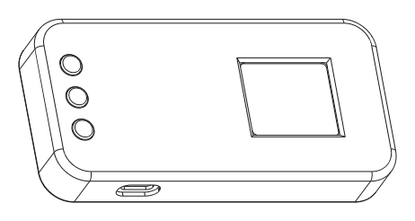
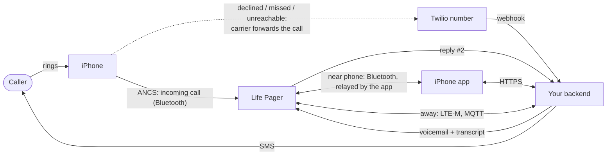

# Life Pager

A small, quiet device that tells you **who is calling** and nothing else, so the phone can
stay in a drawer. From the pager you can decline a call, text the caller one of a few preset
replies ("Away from my phone, will call you back in 10"), and read your voicemail.

It works next to the phone over Bluetooth, and on its own over LTE-M when the phone is
somewhere else.

102 x 50 x 15.6 mm. Always-on reflective display, three buttons, USB-C, vibration only.

## How it works in one picture

- **Call alerts** come from iOS itself (Apple Notification Center Service). The pager asks
  for the *incoming call* category only, so no other notification can reach it.
- **Replies and voicemail** go through a phone number you rent from Twilio. Your carrier
  forwards calls you decline or miss to it; a small server you host records the voicemail,
  transcribes it, and sends the text replies.
- **Away from the phone**, the pager switches on its LTE-M modem and talks to that server
  directly. Calls reach it after they ring out on the phone (about 20-25 s).

Why it is built this way, and what was ruled out (Wi-Fi, Amazon Sidewalk, LoRa, sending
texts from your own number), is in [docs/architecture.md](docs/architecture.md).

## What is in this repository

| Folder | Contents | State |
|---|---|---|
| [`docs/`](docs) | Architecture, wire protocol, build guide | Complete |
| [`hardware/`](hardware) | Circuit as a checked netlist, generated schematic and BOM, power budget | Design complete; **not yet built** |
| [`enclosure/`](enclosure) | Parametric CadQuery model, STL + STEP for all four printed parts | Generated, interference-checked; **not yet printed** |
| [`firmware/`](firmware) | Zephyr / nRF Connect SDK app | Protocol + UI logic host-tested; hardware drivers **not yet compiled** |
| [`backend/`](backend) | Node service: Twilio voicemail, SMS replies, pager sync | 15 passing tests |
| [`ios/`](ios) | SwiftUI companion app | Written; **not yet compiled** |
| [`protocol/`](protocol) | Test vectors shared by firmware and backend | Both implementations pass |

Nothing here has touched real hardware yet. The design was done without parts on the bench,
an nRF toolchain or Xcode, so treat it as a complete, reviewed design plus tested core logic -
not a finished product. [docs/build-guide.md](docs/build-guide.md) orders the work so each
uncertain piece is proven before the next one depends on it, and lists every dimension and
pin that must be measured first.

## Build it in three stages

| Stage | You get | Needs |
|---|---|---|
| 1. Bluetooth pager | Call alerts with caller name, decline from the pager | XIAO nRF52840, display, buttons, motor, battery, printed case |
| 2. Replies + voicemail | Preset text replies, voicemail transcripts on the pager, audio in the app | + Twilio number, backend, iPhone app, call forwarding |
| 3. Away mode | All of the above with the phone left at home | + nRF9151 board, SIM, MQTT broker |

Parts come to roughly $105 (estimate, [hardware/bom.csv](hardware/bom.csv)); running costs
are a few dollars a month for the Twilio number and SIM.

## Honest limits

- Replies are sent **from the pager's Twilio number, not your own**. iOS gives no way for an
  accessory or background app to send a text as you. Each reply starts with your name.
- You cannot answer or talk on the pager. It has no microphone or speaker by design.
- Voicemail is read as a transcript on the pager; audio plays in the iPhone app.
- Forwarding to Twilio replaces your carrier's voicemail (and Visual Voicemail).
- Away from the phone, a call shows up only after it has rung out.
- US texting from a Twilio number needs a one-time A2P 10DLC (or toll-free) registration.
