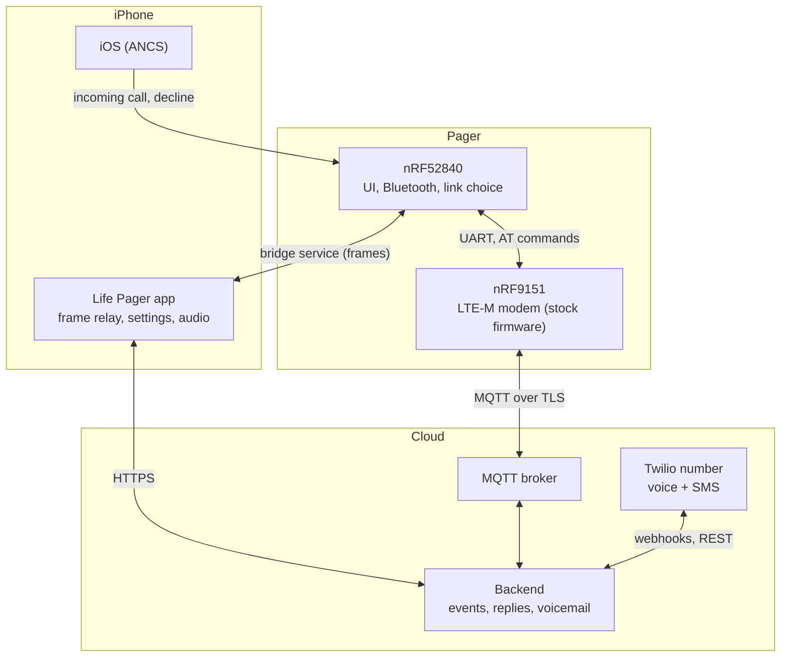
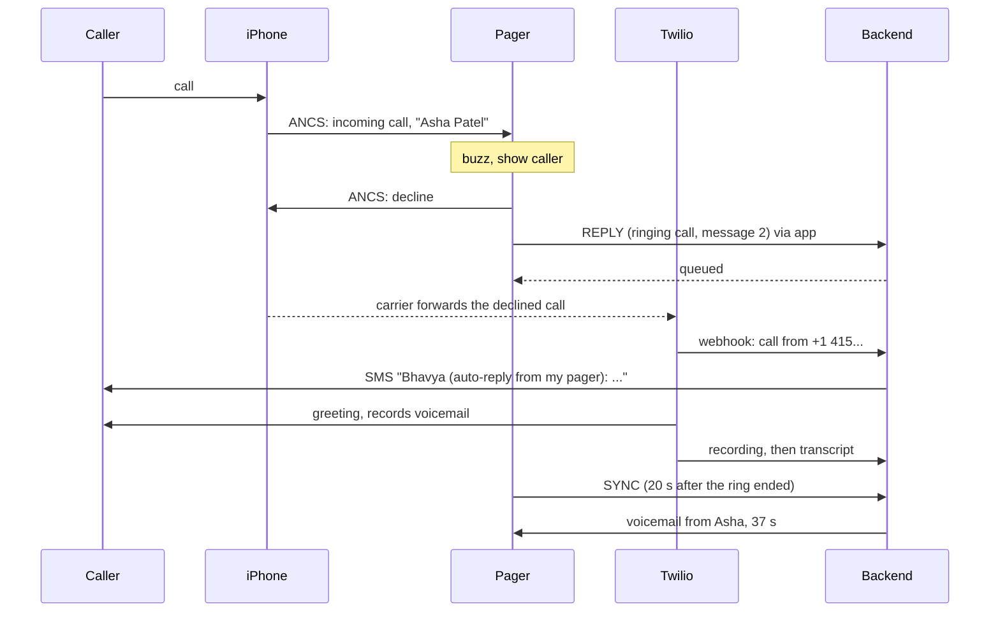
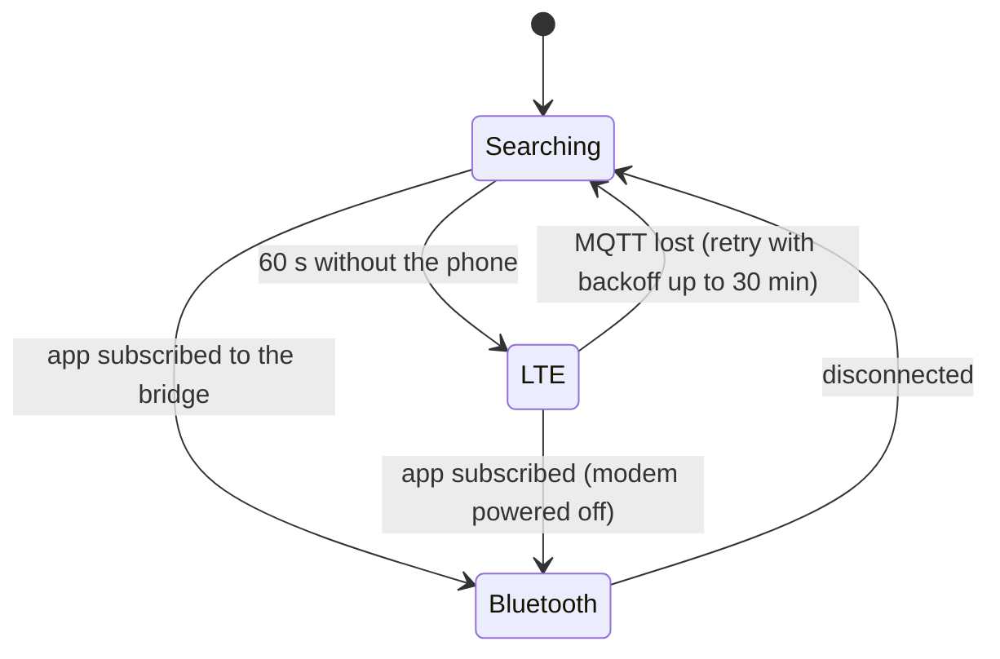

# Architecture

## Goal

Leave the phone in another room, or at home, and still:

1. know when someone calls, and who;
2. answer them with one of a few preset texts;
3. go through voicemail.

Nothing else reaches the device. No apps, no messages, no feeds.

## The constraints that shape everything

These are properties of iOS and of phone networks, not choices.

| Fact | Consequence |
|---|---|
| iOS shares notifications with a paired Bluetooth accessory through ANCS, including incoming calls with the caller's name, and lets the accessory decline the call. No app is involved. | Call alerts near the phone are simple and reliable. This is the pager's primary path. |
| An iOS app cannot see who is calling, cannot run continuously in the background, and cannot send an SMS without the user tapping Send. | The phone cannot forward calls to the pager over the internet, and cannot send the replies. |
| Every carrier can forward calls that are declined, unanswered or unreachable to another number, keeping the original caller ID. | A number we control can take over from the phone exactly when the user is not picking up. That is where voicemail and replies live. |
| Bluetooth reaches about 10 m indoors. | "Phone not nearby" needs a second radio with real range. |

## System

| Component | Responsibility | Deliberately does not |
|---|---|---|
| Pager MCU | Everything the user sees and presses; picks Bluetooth or LTE | Know phone numbers' owners, hold credentials for Twilio |
| LTE modem | IP connectivity when away | Run any custom code |
| iOS / ANCS | Tell the pager a call is ringing; decline on request | Anything else - the pager ignores every other category |
| iPhone app | Carry frames between pager and backend; edit settings; play audio | Interpret pager frames, show alerts |
| Backend | Record what calls reached voicemail; send replies; store voicemail | Talk to the phone |
| Twilio | Answer forwarded calls, record, transcribe, send SMS | |

## What happens when someone calls

### Phone nearby

The reply and the call meet at the backend: the pager only says "reply to whoever is ringing
now", and the backend learns the number when the forwarded call arrives. That keeps phone
numbers off the Bluetooth link and avoids needing anything from iOS beyond ANCS.

### Phone somewhere else

The phone rings unanswered (or is off). After the carrier's no-answer timeout the call is
forwarded, Twilio answers, and the backend publishes the event over MQTT. The pager, idle on
LTE-M, receives it within its eDRX cycle (about 20 s worst case), buzzes and shows the number
(or the name, if you synced contacts). Reply and voicemail work as above, over LTE.

Net delay from first ring to buzz when away: the carrier's ring timeout (15-30 s) plus up to
20 s. That is acceptable for a device whose purpose is to let you *not* answer immediately.

## Choosing the away-from-phone link

| Option | Range | Works anywhere | Latency | Standby cost | Verdict |
|---|---|---|---|---|---|
| Bluetooth only | 10 m | no | instant | tens of uA | Needed anyway (ANCS). Not enough alone. |
| Wi-Fi | one building | only on networks you set up | seconds | milliamps to stay associated | Covers "phone upstairs", fails the moment you leave. Rejected. |
| Amazon Sidewalk | neighbourhood | US only, and only near other people's Echo/Ring devices | seconds to minutes | low | No coverage guarantee, AWS device onboarding, tiny daily data allowance. Rejected as the main link. |
| LoRa / Meshtastic | km | only where you run a gateway | seconds | low | You would be building the network too. Rejected. |
| **LTE-M** | cellular | yes, on a $1-2/month IoT SIM | 20 s with eDRX | 0.3-0.6 mA | **Chosen.** The only option that is true to "even if my phone is not close by". |

LTE-M is switched on only after the phone has been out of Bluetooth range for a minute, and
off again when it returns, so day-to-day battery life is set by Bluetooth.

## Choosing where replies come from

| Option | Problem |
|---|---|
| iPhone sends the SMS from your number | iOS has no API for an accessory or background app to send a text. Shortcuts cannot be triggered by a Bluetooth accessory. |
| Pager's own SIM sends the SMS | IoT SIMs generally cannot text ordinary phones, and it would not work near the phone without LTE. |
| **Twilio number sends it** | Different number from yours. Mitigated by starting every text with your name and "auto-reply from my pager". Works identically near and away. **Chosen.** |

## Voicemail

Forwarding to Twilio replaces carrier voicemail, which is what makes it readable from the
pager: carrier voicemail has no API. The pager shows the transcript (first 640 bytes) and can
mark it heard or delete it. Audio is available in the iPhone app. Putting a speaker in the
pager was considered and left out of Rev A: it adds an amplifier, a speaker, an audio decoder
and megabytes of LTE data for something a transcript does in two seconds.

## Link selection in the firmware

ANCS call alerts are independent of this: they work whenever the phone is connected, even if
the app is not running and no backend exists.

## Security and privacy

- **Bluetooth**: one bonded phone; both bridge characteristics require an encrypted link.
  ANCS itself is only offered by iOS to bonded accessories the user approved.
- **Backend**: Twilio webhooks are signature-checked; the app API needs a bearer token of at
  least 24 characters, compared in constant time, kept in the iOS Keychain.
- **LTE**: MQTT over TLS with a per-device username and password; the broker ACL confines the
  pager to its own topics.
- **Reply abuse**: the pager can only select a message by index, and the backend only texts
  numbers that called it - a stolen pager or leaked token cannot send arbitrary texts to
  arbitrary people. One reply per caller per minute.
- **Data held**: call log, voicemail audio (at Twilio) and transcripts, contact names if you
  sync them. All on infrastructure you control; nothing is shared with anyone else.
- **Known gap**: the MQTT password is compiled into the firmware and the XIAO's debug port is
  open. Someone with the pager and a debugger could read it. Acceptable for a personal build;
  Rev B should enable readback protection.

## Failure behaviour

| Situation | What the user sees |
|---|---|
| Backend down, phone nearby | Call alerts and decline still work. Replies show "Sending..." then nothing; voicemail does not update. |
| App force-quit by the user | Same as above until the app is opened once (iOS stops relaunching force-quit apps). |
| No LTE coverage when away | Status bar shows `--`. The modem retries with exponential backoff to protect the battery. |
| Reply chosen but the call never reaches voicemail (caller hung up first) | "Reply queued", then it expires after 2 minutes. Nothing is sent to anyone. |
| Caller withheld their number | "No number to text". |

## Roadmap

1. **Rev A** (this repository): module-based hardware, printed case.
2. Measure real power figures; tune eDRX and keep-alive per carrier.
3. Firmware update over Bluetooth (MCUboot + mcumgr) so the case never needs opening.
4. **Rev B**: single custom PCB, about 70 x 40 x 10 mm, readback protection, proper fuel gauge.
5. Optional: short audio playback on the pager.
