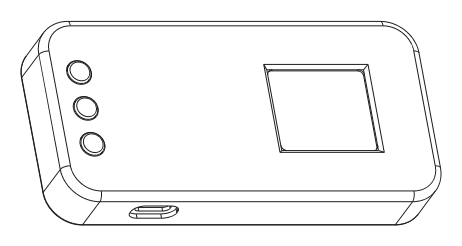
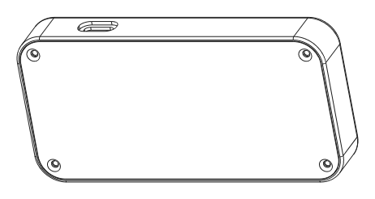
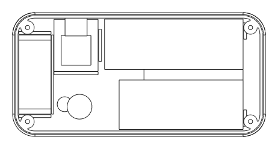
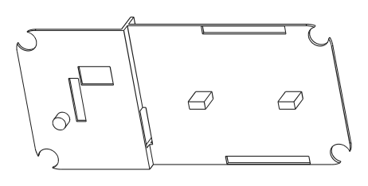

# Enclosure

Parametric model in [CadQuery](https://cadquery.readthedocs.io) - one Python file, every
dimension a named constant.

```bash
pip install cadquery
```

```bash
python3 enclosure/pager.py
```

That regenerates `out/*.stl` (print these), `out/*.step` (open in Fusion, FreeCAD, Onshape),
`out/assembly.step` (printed parts plus keep-out blocks for the electronics) and prints an
interference report. The script exits non-zero if any two solids overlap.

| | |
|---|---|
|  |  |
|  |  |

Bottom left is the shell seen from the back with the electronics in place: button strip and
XIAO at one end, battery and nRF9151 board side by side over the display.

## Parts

| File | Qty | Print orientation | Notes |
|---|---|---|---|
| `shell.stl` | 1 | face down | The face is the bed surface - a textured PEI sheet gives the best finish. No supports. |
| `tray.stl` | 1 | flat deck down | Needs supports under the raised deck, or split at the step and glue. |
| `back_plate.stl` | 1 | outside face down | |
| `button_cap.stl` | 3 | flange down | |

0.2 mm layers, 3 perimeters, PETG or PLA. Fasteners: 4x M2 x 8 mm self-tapping countersunk
screws (for heat-set inserts set `SCREW_PILOT_D = 3.2`).

## How it goes together (face down on the desk)

1. Drop the three button caps into their holes.
2. Display breakout, glass down, between its four corner brackets.
3. Button strip onto its rails with the switches facing the caps; XIAO onto its rails with
   USB-C in the wall opening.
4. Tray on top. It clamps the display and covers the button strip and XIAO.
5. nRF9151 board and battery on the tray's lower deck; vibration motor and LTE antenna stuck
   to the inside of the back plate.
6. Back plate, four screws.

## Measure before you print the final copy

The model was built from published dimensions, not from parts in hand. Check these with
calipers and edit the constants at the top of `pager.py`:

| Constant | What to measure |
|---|---|
| `DISP_PCB`, `DISP_T` | display breakout outline and total thickness |
| `WIN_OFF` | where the glass's active area sits relative to the board centre |
| `KIT` | nRF9151 board, especially its height with the SIM fitted |
| `BATT` | your actual cell |
| `XIAO_Z` / `USB_Z` | height of the USB-C receptacle above the XIAO's underside |
| `SW_H` | switch height from board to actuator tip |

Print the shell once in draft quality as a fit check before committing to a slow, pretty one.

## Design notes

- The display window is a plain opening with a bevel. For dust protection glue a 28 x 24 mm
  piece of 0.5 mm clear PETG behind it and add its thickness to `FACE`-side clearance
  (`DISP_TOP_Z`).
- Rev A is sized by off-the-shelf boards. A custom PCB (Rev B, see the architecture doc)
  would bring it to roughly 70 x 40 x 10 mm.
