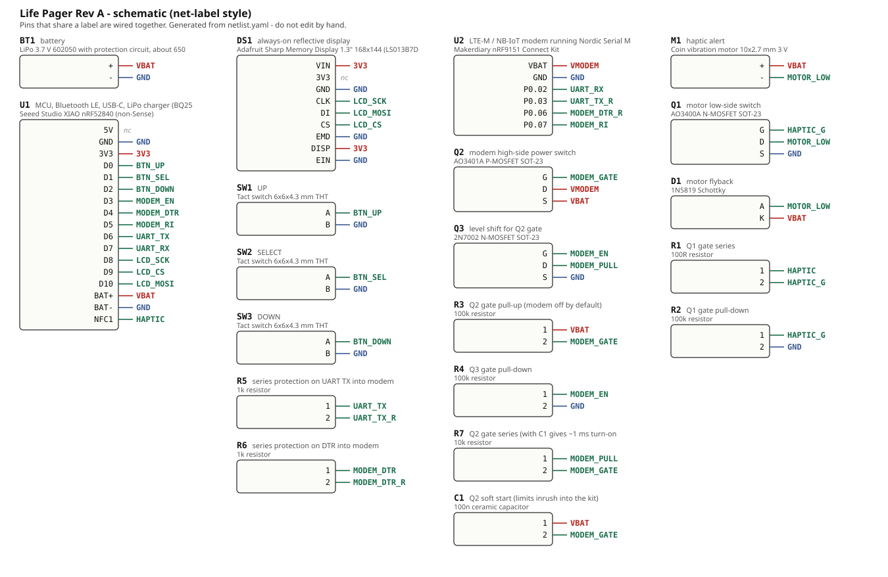

# Hardware (Rev A)

Rev A is built from ready-made boards joined with a couple of dozen wires, so it needs no
custom PCB and no RF layout. The circuit lives in [`netlist.yaml`](netlist.yaml); the
schematic and BOM are generated from it and checked on every run:

```bash
python3 hardware/tools/build.py
```



## Blocks

| Block | Part | Why this one |
|---|---|---|
| MCU + Bluetooth + charger | Seeed XIAO nRF52840 | 21 x 18 mm, USB-C and LiPo charger on board, microamp sleep, first-class Zephyr and ANCS support |
| LTE-M modem | Makerdiary nRF9151 Connect Kit | Certified nRF9151 with SIM slot and antenna connector; runs Nordic's stock Serial Modem firmware, so no modem code to write |
| Display | Sharp memory LCD 1.3" 168x144 (Adafruit 3502) | Always on at microwatts, readable in sunlight, fast enough to scroll text; no backlight |
| Alert | 10 mm coin vibration motor | Silent, felt in a pocket |
| Input | 3 tact switches | Up / Select / Down is the minimum that navigates lists |
| Battery | 602050 LiPo, about 650 mAh | Fits beside the modem board |

## Pin map (XIAO nRF52840)

| Pin | GPIO | Net | Notes |
|---|---|---|---|
| D0 | P0.02 | BTN_UP | to GND, internal pull-up |
| D1 | P0.03 | BTN_SEL | |
| D2 | P0.28 | BTN_DOWN | |
| D3 | P0.29 | MODEM_EN | high = modem powered |
| D4 | P0.04 | MODEM_DTR | via 1k |
| D5 | P0.05 | MODEM_RI | input, pull-down |
| D6 | P1.11 | UART_TX | via 1k to modem P0.03 |
| D7 | P1.12 | UART_RX | from modem P0.02 |
| D8 | P1.13 | LCD_SCK | |
| D9 | P1.14 | LCD_CS | active high |
| D10 | P1.15 | LCD_MOSI | |
| NFC1 pad | P0.09 | HAPTIC | underside pad; firmware turns the NFC pins into GPIOs |
| BAT+ / BAT- pads | | VBAT / GND | underside pads |

Every GPIO on the XIAO's edge is used. Battery voltage is read on the XIAO's built-in divider
(P0.31, enabled by P0.14).

## Circuit notes

- **Modem power switch (Q2, Q3, R3, R4, R7, C1).** A P-MOSFET in the battery feed to the
  nRF9151 board, off by default. Near the phone the modem draws nothing at all. A GPIO cannot
  drive the P-FET gate directly (3.3 V logic against a 4.2 V source would leave it half on),
  so Q3 level-shifts. R7 and C1 slow the turn-on to about a millisecond to tame the inrush
  into the board's input capacitors.
- **Series resistors R5, R6.** When the modem is unpowered its pins must not be fed from the
  XIAO. The firmware sets those pins high-impedance first; the resistors limit current if it
  ever does not.
- **Motor driver (Q1, D1, R1, R2).** Low-side N-MOSFET, flyback diode across the motor, gate
  pull-down so the motor stays off during reset.
- **Display.** EXTMODE and EXTCOMIN are tied low: the driver toggles VCOM in software. DISP is
  tied to 3V3.
- **Logic levels.** The XIAO is 3.3 V. The nRF9151 board can run its I/O at 1.8 V or 3.3 V -
  it **must** be set to 3.3 V. Measure it before connecting the two.
- **Charging.** Through the XIAO's USB-C at 100 mA (about 7 hours for a full charge). The
  nRF9151 board's own USB port and charger are unused in normal operation; that port is only
  for flashing the modem.

## Power budget

Estimates from datasheet figures, to be replaced with measurements (a Nordic PPK2 is the
right tool). Battery: 650 mAh.

| State | Draw (estimate) | Runtime (estimate) |
|---|---|---|
| Near phone: BLE connected, display on, modem off | 60-100 uA | several months |
| Away: LTE-M idle with 20 s eDRX, MQTT keep-alive every 15 min, BLE advertising | 0.3-0.6 mA | 6-12 weeks |
| Away with poor coverage (modem retrying, backed off to 30 min) | 1-3 mA | 1-4 weeks |
| Vibration | 80 mA while buzzing | a few mAh per day at most |

The two unknowns that decide the away-mode figure are the Connect Kit's own idle overhead
(its regulator and interface chip) and your network's eDRX support. Measure both early.

## Before you solder: verify list

1. XIAO underside pads: locate BAT+, BAT-, NFC1 on Seeed's pinout drawing.
2. nRF9151 board: I/O voltage is 3.3 V; P0.02, P0.03, P0.06, P0.07 are on the header and free
   (otherwise choose others and edit `firmware/modem/pager_modem.overlay` and this netlist);
   which pin or pad is the battery input.
3. Display breakout: pin order on its header; `3V3` is an output and stays unconnected.
4. Battery: has a protection circuit, and its lead polarity matches where you solder it.

## Rev B (not done here)

One custom 4-layer board with the bare nRF9151 SiP, an nRF54L15 module, an nPM1300 power
IC, the bare LS013B7DH03 glass on an FPC connector, and side buttons: about 70 x 40 x 10 mm.
It needs RF layout and antenna tuning, so it should follow a working Rev A, not replace it.
