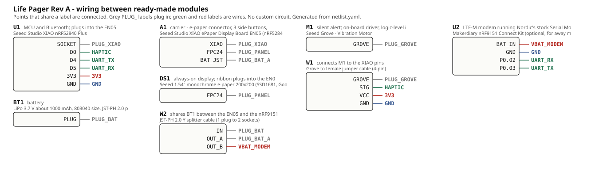

# Hardware (Rev A): ready-made modules only

No custom circuit board, no transistors or resistors to solder. The pager is four ready-made
boards that plug together, plus a battery. Away mode adds one more board. The wiring lives in
[`netlist.yaml`](netlist.yaml); the diagram and parts list are generated from it and checked on
every run:

```bash
python3 hardware/tools/build.py
```



## Parts

| Ref | Part | What it does | Why this one |
|---|---|---|---|
| U1 | Seeed **XIAO nRF52840 Plus** | Bluetooth, the firmware, USB-C, battery sensing | Microamp sleep, Zephyr board support, ANCS; the EN05 is designed for it |
| A1 | Seeed **XIAO ePaper Display Board EN05** | Carrier: e-paper connector, 3 side buttons, battery connector, power switch, charging | Turns the XIAO into a display device with no wiring |
| DS1 | Seeed **1.54" e-paper, 200x200** (SSD1681) | Always-on display | Keeps its image with zero power; readable in sunlight |
| M1 | Seeed **Grove Vibration Motor** | Silent alert | Has its own driver on board: one logic pin turns it on |
| W1 | Grove to female jumper cable | Connects M1 to the XIAO | |
| BT1 | 3.7 V LiPo, about 1000 mAh, 803040, JST-PH 2.0 | Battery | Plugs straight into the EN05 |
| U2 | Makerdiary **nRF9151 Connect Kit** *(optional)* | LTE-M modem for away mode | Certified modem with SIM slot and antenna; runs Nordic's stock firmware |
| W2 | JST-PH 2.0 Y splitter *(only with U2)* | Shares the battery with U2 | |

Prices and the total are estimates in [bom.csv](bom.csv) (about $46 without away mode, about
$107 with it).

## Connections

| From | To | How |
|---|---|---|
| XIAO nRF52840 Plus | EN05 | Plugs onto it |
| E-paper ribbon | EN05 24-pin connector | Plug in, contacts as marked |
| Battery | EN05 battery socket | Plug in (via W2 when U2 is fitted) |
| Grove motor | XIAO **D0**, **3V3**, **GND** | Grove cable into the motor; its three jumper ends soldered to the XIAO's edge pads |
| nRF9151 kit P0.02 (TX) | XIAO **D5** (RX) | Wire *(optional)* |
| nRF9151 kit P0.03 (RX) | XIAO **D4** (TX) | Wire *(optional)* |
| nRF9151 kit GND | XIAO GND | Wire *(optional)* |
| W2 second plug | nRF9151 kit battery input | Plug in *(optional)* |

The soldering is three wires for the motor (six with away mode), each onto a pad. There is
nothing to design or lay out.

## What the EN05 already uses

From Seeed's EN05 documentation and its display library (`Seeed_GFX2`,
`XIAO_ePaper_Board_Configs.h`), mapped to GPIOs with Zephyr's `xiao_nrf52840_plus` board docs:

| XIAO pin | GPIO | EN05 function |
|---|---|---|
| D1 | P0.03 | KEY1 (we use it as Up) |
| D2 | P0.28 | KEY2 (Select) |
| D9 | P1.14 | KEY3 (Down) |
| D3 | P0.29 | e-paper BUSY |
| D6 | P1.11 | e-paper power enable |
| D7 | P1.12 | e-paper CS |
| D8 | P1.13 | e-paper SCK |
| D10 | P1.15 | e-paper MOSI |
| D11 (back pad) | P0.15 | e-paper RESET |
| D16 (back pad) | P0.31 | e-paper DC, **also** the XIAO's battery-voltage input |

That leaves exactly **D0, D4 and D5** free: the motor gets D0, the modem's serial link gets D4
and D5. This is why it must be the *Plus* XIAO: the EN05 needs its extra back pads.

## Power budget

Estimates to replace with measurements (a Nordic PPK2 is the right tool).

| Configuration | State | Draw (estimate) | 1000 mAh lasts |
|---|---|---|---|
| Without U2 | Phone nearby, Bluetooth connected, display idle | 40-100 uA | months |
| With U2 | Phone nearby, modem radio off but powered | adds the kit's idle draw: **measure it** | weeks to months |
| With U2 | Away: LTE-M idle with 20 s eDRX | 0.3-0.6 mA plus kit overhead | several weeks |
| Any | Each e-paper update (about 0.3 s partial refresh) | a few mA briefly | negligible at pager rates |

The one real unknown is the nRF9151 kit's draw when its radio is off. With only ready-made
parts there is no switch to cut its power entirely, so its own regulator and interface chip keep
running. If that turns out to be more than about 0.5 mA, the fixes are, in order: unplug the kit
when you know you will be near the phone for days, or add a ready-made load-switch breakout
controlled from a pin on the EN05's extension port.

## Before you plug anything in: verify list

1. **Battery polarity.** JST-PH red/black order is not standardised between sellers. Match the
   EN05's +/- marking.
2. **Panel jumper.** If your EN05 revision has a 24-pin / 50-pin selection, set 24-pin.
3. **Modem I/O voltage** *(U2 only)*. The kit can run its I/O at 1.8 V or 3.3 V. It must be
   3.3 V. Measure before wiring to the XIAO.
4. **Modem header** *(U2 only)*. Confirm P0.02 and P0.03 are free on the kit's header and which
   connector is its battery input.

## Known limitations of the module build

- **Bigger than a custom board.** 107 x 47 x 14 mm (Bluetooth only) or 110 x 47 x 18.5 mm (with
  LTE). A single custom board would be about 70 x 40 x 10 mm, but that is exactly the custom
  circuit this build avoids.
- **The EN05 power switch does not turn off the LTE kit**, because the kit has its own battery
  lead via the Y splitter. Unplug that lead to store the pager.
- **Battery reading shares a pin with the display** (P0.31). The firmware reads the battery only
  between display updates, which is fine, but it means the reading is less frequent.
